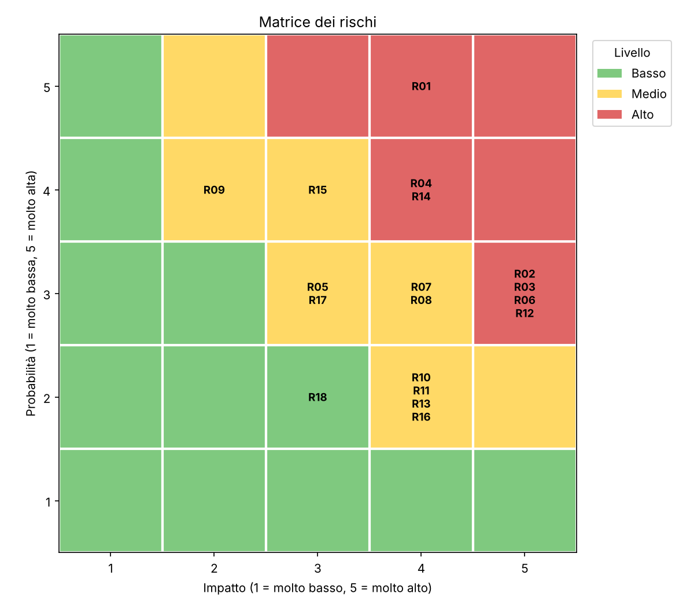

# Risk Assessment Tool

Piccolo strumento in Python per la valutazione del rischio informatico, ispirato al processo di risk assessment di **ISO/IEC 27001:2022**.

Il progetto nasce come esercizio per applicare l'analisi del rischio a un caso concreto: dati un elenco di asset e di rischi, calcola il livello di ciascun rischio, indica quali vanno trattati e propone i controlli dell'Annex A da considerare.

## Lo scenario (fittizio)

Uno studio legale di 15 persone a Roma, con server in ufficio, gestionale e posta in cloud, notebook usati anche fuori sede e un fornitore IT esterno. Azienda e dati sono **inventati** e servono solo a dimostrare il metodo.

## Come funziona

1. **Asset** (`data/assets.csv`): ciò che va protetto (server, account, dati dei clienti, fornitori...).
2. **Rischi** (`data/risks.csv`): per ogni rischio si indicano asset, minaccia, vulnerabilità, probabilità e impatto, entrambi da 1 a 5.
3. **Calcolo**: `punteggio = probabilità × impatto` (da 1 a 25).

   | Punteggio | Livello | Trattamento |
   |---|---|---|
   | 1–6 | Basso | Accettare e monitorare |
   | 7–12 | Medio | Trattare |
   | 13–25 | Alto | Trattare |

4. **Controlli** (`data/controls.csv`): per i rischi da trattare lo strumento propone i controlli dell'Annex A associati alla categoria del rischio, con un'azione concreta.
5. **Output** nella cartella `output/`:
   - `risk_report.csv`: tutti i rischi ordinati dal più alto al più basso;
   - `risk_matrix.png`: matrice dei rischi con probabilità e impatto.



## Come usarlo

Servono Python 3.9 o superiore e `matplotlib`.

```bash
pip install -r requirements.txt
python risk_assessment.py
```

Opzioni:

```bash
python risk_assessment.py --data data --out output
```

Per analizzare un altro scenario basta modificare i tre file CSV. Lo script controlla i dati e segnala errori come valori fuori da 1–5, asset inesistenti o categorie senza controlli.

## Test

```bash
python -m unittest discover -s tests
```

## Struttura

```
risk-assessment-tool/
├── risk_assessment.py        # script principale
├── data/                     # asset, rischi e controlli (CSV)
├── output/                   # report e matrice generati
├── tests/                    # test automatici
└── requirements.txt
```

## Limiti

- Il metodo è **semplificato** a scopo didattico: scale 1–5, tre livelli, un solo valore di impatto invece delle tre dimensioni di riservatezza, integrità e disponibilità.
- I rischi sono valutati **prima** dei controlli (rischio inerente). Non è calcolato il rischio residuo.
- L'associazione tra categorie di rischio e controlli è **indicativa**: in un vero progetto va scelta in base al contesto e documentata nella Dichiarazione di Applicabilità.
- Non sostituisce una valutazione svolta da professionisti né una certificazione.

## Possibili sviluppi

- Calcolare il rischio residuo dopo l'applicazione dei controlli.
- Distinguere impatto su riservatezza, integrità e disponibilità.
- Aggiungere responsabile e scadenza per ogni azione di trattamento.
- Generare il report anche in HTML o PDF.
